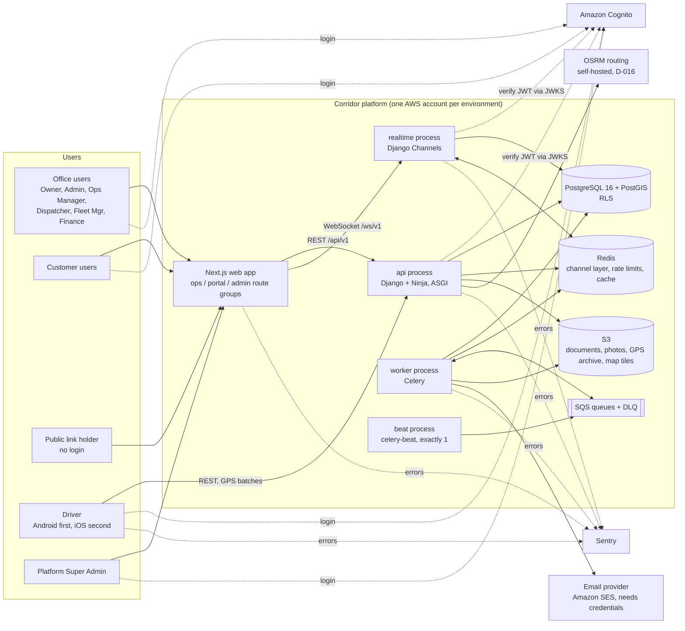
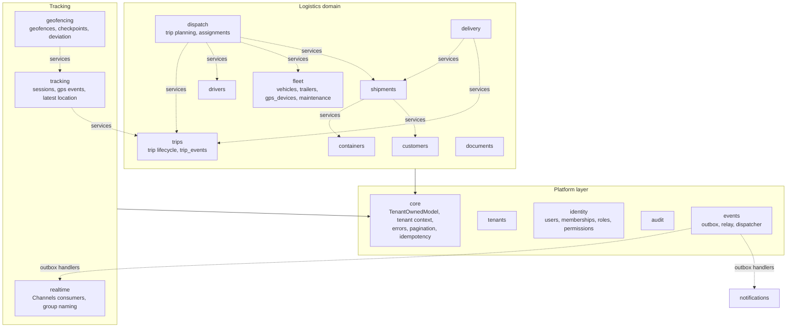
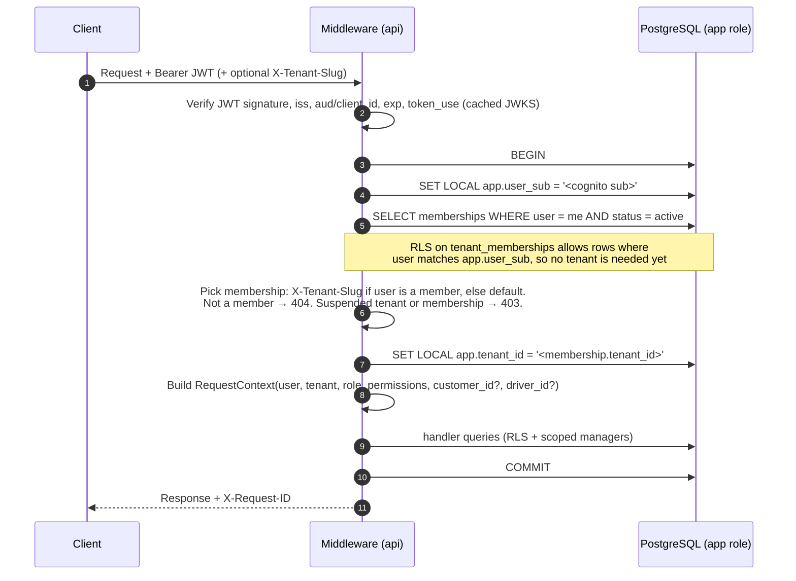
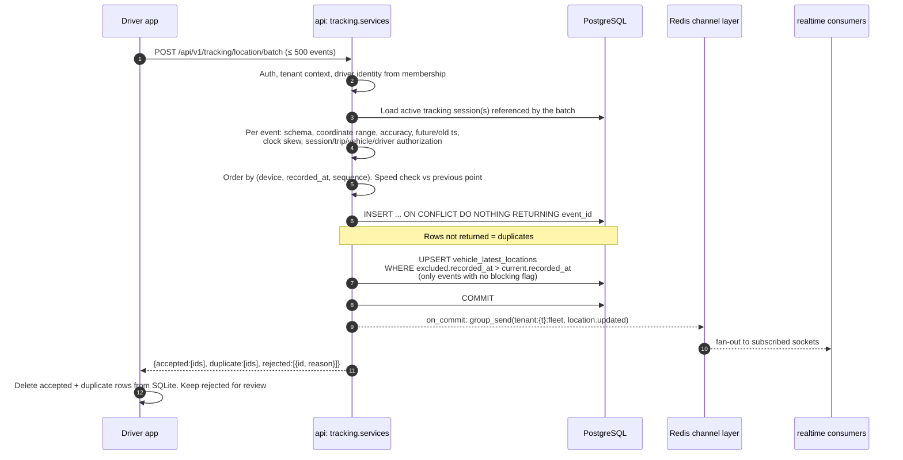
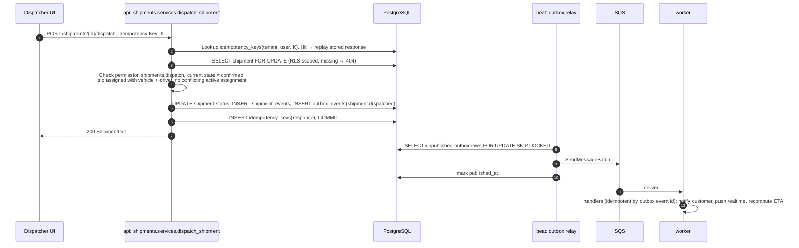

# Architecture overview

Status: Phase 0 design. Nothing here is implemented yet. Fixed decisions come from `MASTER_PROMPT.md` §2. Choices made in this phase are in `DECISIONS.md` and referenced by ID (D-xxx).

## 1. System context

## 2. Processes (one Docker image, D-002)

| Process | Command (planned) | Responsibilities | Scale (pilot) |
|---|---|---|---|
| `api` | `gunicorn config.asgi:application -k uvicorn.workers.UvicornWorker` | REST API, GPS ingestion (inline, D-011), file pre-signing, health endpoints | 1–2 tasks |
| `realtime` | `daphne config.asgi:application` (Channels router, WebSocket only) | WebSocket auth, group subscription, fan-out of location and business events | 1 task |
| `worker` | `celery -A config worker` | Outbox event handlers, notifications, geofence/checkpoint evaluation, ETA recompute, retention archive | 1 task |
| `beat` | `celery -A config beat` | Outbox relay tick, freshness sweep, partition maintenance, retention, idempotency-key expiry | exactly 1 task (D-009) |

The brief describes "three processes" and also a separate beat task in the pilot config. Beat is the scheduler, not a fourth service type. It runs from the same image and must be a singleton.

## 3. Module map (Django apps under `backend/corridor/`)

Module boundary rules (D-005):
- A module's `models.py` is private. Other modules call its `services.py` functions, which return plain dataclasses or Pydantic DTOs, not model instances.
- Cross-module foreign keys exist at the database level for referential integrity, declared with string references such as `"customers.Customer"`. No ORM traversal across a module boundary (`shipment.customer.name` in shipments code is forbidden). The owning module's service resolves the data.
- Boundaries are enforced in CI with `import-linter` contracts: only `<module>.services` and `<module>.schemas` may be imported from outside the module.

## 4. Key flows

### 4.1 Authenticated request and tenant context (D-006, D-007)

The client may name which of its own memberships to act under. It can never supply a tenant id that is trusted. Any `tenant_id` in a request body is ignored by the schemas (they do not declare the field).

### 4.2 GPS batch ingestion (D-011, D-012, D-013)

Realtime push is a non-critical side effect (`transaction.on_commit`). If Redis is down, the location is still stored and clients catch up by polling `GET /vehicles/{id}/location`.

### 4.3 Business transition (example: dispatch shipment) (D-014)

## 5. Cross-cutting concerns

| Concern | Approach |
|---|---|
| Errors | One envelope: `{"error": {"code", "message", "details", "request_id"}}`. Other tenants' resources return 404 `not_found`. |
| Pagination | Cursor pagination (`?cursor=&limit=`, max 200) on lists. |
| Idempotency | `Idempotency-Key` required on state-changing POSTs. Stored per (tenant, user, key) with a request hash. Same key with a different body returns 422. Expires after 24 h (D-015). |
| Correlation | `X-Request-ID` accepted (if well formed) or generated. Bound into structlog context, Celery task headers and Sentry tags. |
| Time | All timestamps are `timestamptz` in UTC. The UI renders in EAT (UTC+3; Djibouti and Ethiopia share the offset). The Ethiopian calendar is not in the pilot (D-020). |
| Money | `amount_minor BIGINT` + `currency CHAR(3)`. Exponents: DJF 0, ETB 2, USD 2 (ISO 4217) (D-021). |
| i18n | Django `gettext` with `en`, `fr`. Web uses `next-intl` with logical CSS properties so RTL (Arabic) can be added. Mobile uses `i18next`. |
| Rate limits | Redis token buckets keyed by (tenant, user) and by IP for public endpoints. GPS endpoints get their own higher bucket per device. |
| Seed data | `manage.py seed_demo` creates a tenant flagged `is_demo=true` named "DEMO — …". It refuses to run unless `DJANGO_ENV=development`. The UI shows a DEMO banner for demo tenants. |

## 6. GPS freshness model

Freshness is computed from `now() - recorded_at` and session state. It is never stored as a column that could go stale.

| State | Rule | UI |
|---|---|---|
| LIVE | session active and age ≤ 2 min | green, "Live · recorded 14:02:11 · received 14:02:13" |
| DELAYED | ≤ 10 min | amber |
| STALE | ≤ 60 min | grey, "Last seen 37 min ago" |
| OFFLINE | > 60 min or session not active | outlined, "Offline since …" |

Thresholds live in `tenants.settings` with platform defaults. The UI always shows both `recorded_at` and `received_at` (hard rule 3).
