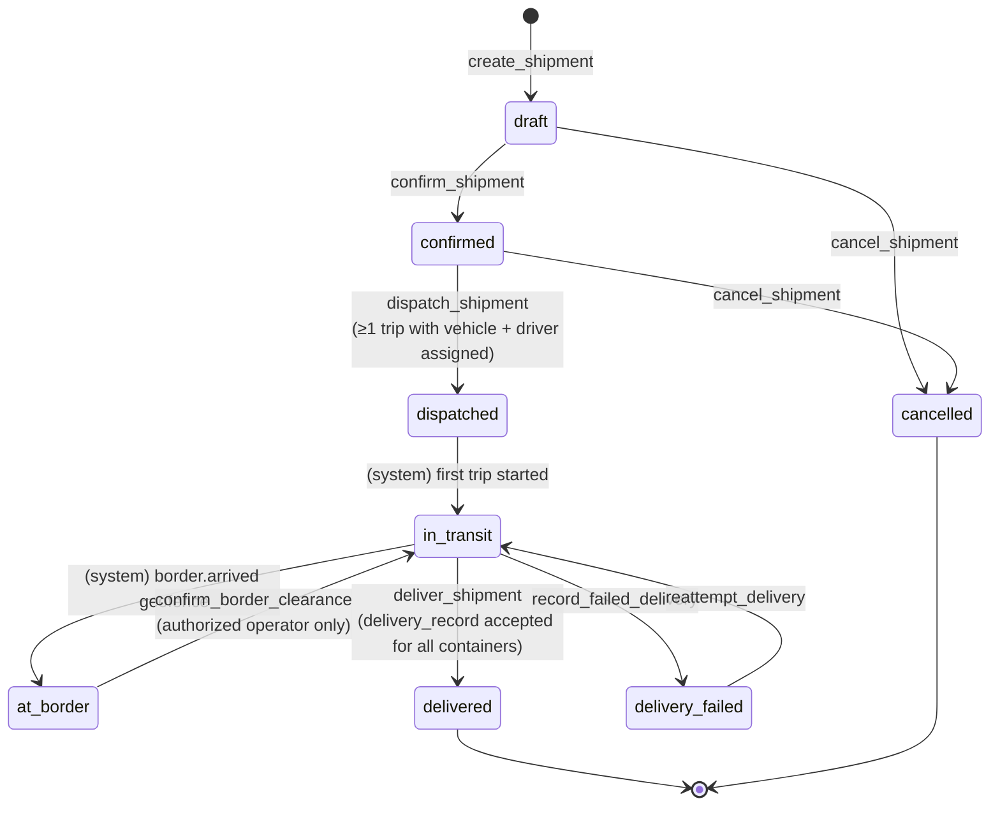
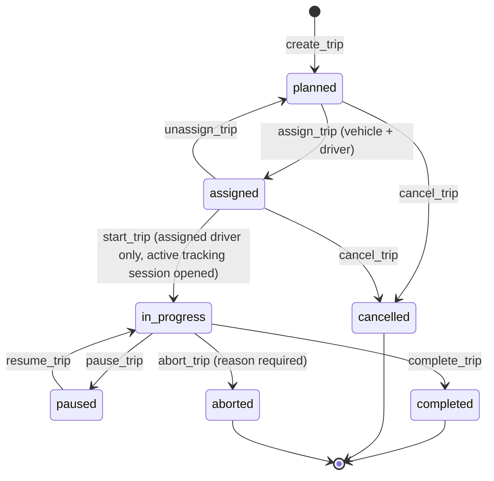
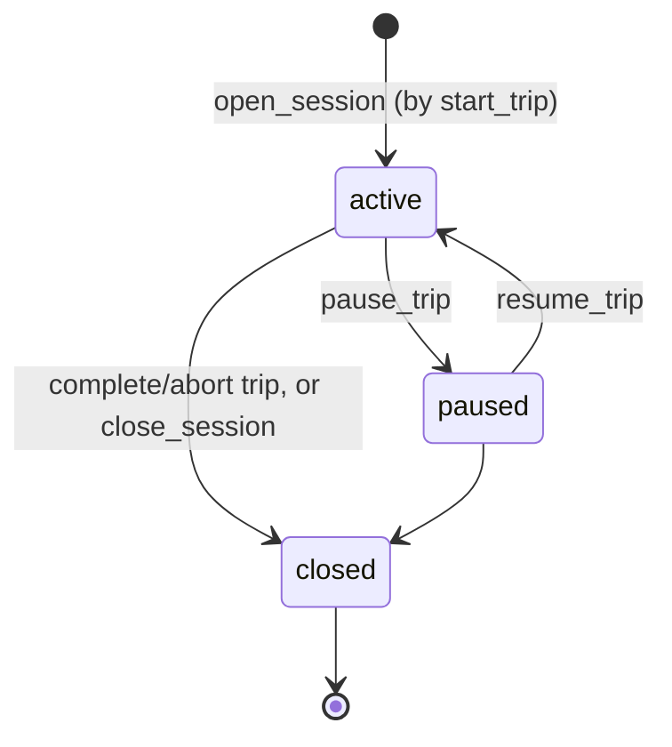

# Lifecycle state machines

Each machine is independent and owned by one module. Transitions are explicit service functions. There is no generic "set status" endpoint, and status fields are read-only in Django admin (D-014).

Every transition follows the same template:

```python
@transition(permission="shipments.dispatch", event="shipment.dispatched")
def dispatch_shipment(ctx: RequestContext, shipment_id: UUID, *, idempotency_key: str) -> ShipmentOut:
    # 1. idempotency lookup (replay if seen)
    # 2. SELECT ... FOR UPDATE through the tenant-scoped manager (missing → NotFound → 404)
    # 3. assert current state in allowed_from
    # 4. business rules (cross-module checks via other modules' services)
    # 5. UPDATE status (conditional: WHERE status = <expected>)
    # 6. INSERT <entity>_events(actor, reason, from, to, payload)
    # 7. INSERT outbox_events if the event is a published business event
    # 8. store idempotency response
```

Corrections (`correct_*`) need the `*.correct` permission and a non-empty `reason`. They are recorded as a new event of type `correction`. Earlier events are never edited.

## Shipment (`shipments`)



- `at_border → in_transit` requires `confirm_border_clearance` by a user with `shipments.confirm_clearance` or a trusted integration principal. GPS geofence entry alone only sets `at_border` (hard rule 8).
- `delayed` is a flag (`is_delayed`, `delay_reason`) plus a `shipment.delayed` event. It is not a state, because a delayed shipment is still in one of the states above.
- Reopening `delivered` is only possible through `correct_shipment_status` (Owner/Admin, with a reason).

## Trip (`trips`)



- `start_trip` can only be called by the driver on the active assignment, or by a dispatcher acting on behalf of the driver with a reason. It opens a tracking session in the same transaction (through `tracking.services.open_session`).
- `complete_trip` needs every route stop marked visited or skipped with a reason. It closes the tracking session.

## Trip assignment (`dispatch`)

`proposed → active → released` (or `active → replaced`). Partial unique indexes:

```sql
CREATE UNIQUE INDEX one_active_assignment_per_vehicle ON trip_assignments (tenant_id, vehicle_id) WHERE status = 'active';
CREATE UNIQUE INDEX one_active_assignment_per_driver  ON trip_assignments (tenant_id, driver_id)  WHERE status = 'active';
CREATE UNIQUE INDEX one_active_assignment_per_trip    ON trip_assignments (tenant_id, trip_id)    WHERE status = 'active';
```

The concurrent dispatch race test relies on these indexes plus `SELECT … FOR UPDATE`. Two threads try to assign the same driver. Exactly one commits, and the other gets `IntegrityError`, which is mapped to 409 `assignment_conflict`.

## Vehicle (`fleet`)

`available ⇄ assigned`, `available ⇄ maintenance`, `any → retired` (terminal). `assigned` is derived from an active assignment and kept in sync by dispatch services. A vehicle in `maintenance` or `retired` cannot be assigned.

## Tracking session (`tracking`)



GPS events are accepted only for a session that is `active`, or `paused` (flagged `while_paused`), or one closed within a grace window (default 24 h) **if** `recorded_at` falls inside the session's active interval. This lets offline drivers upload late without letting anyone write to a closed trip afterwards (D-013).

## Delivery (`delivery`)

`pending → confirmed` (recipient name, signature, ≥ 1 photo, time and location) or `pending → failed` (reason code, photo optional). A confirmed delivery is immutable. Corrections add a new record that supersedes the old one, with a reason.
