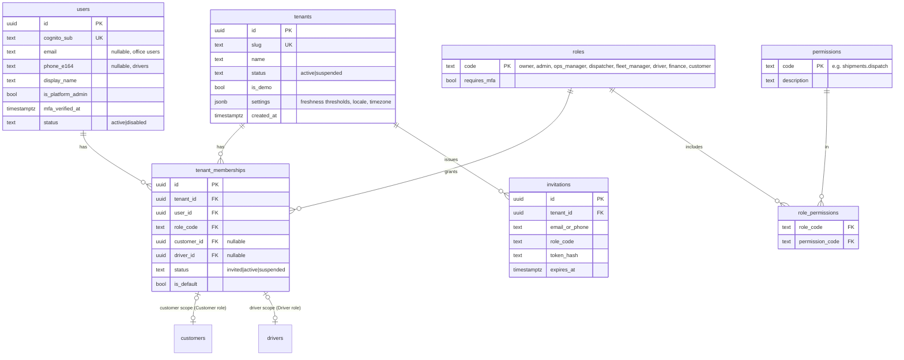
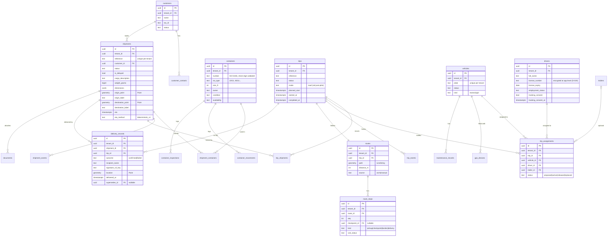
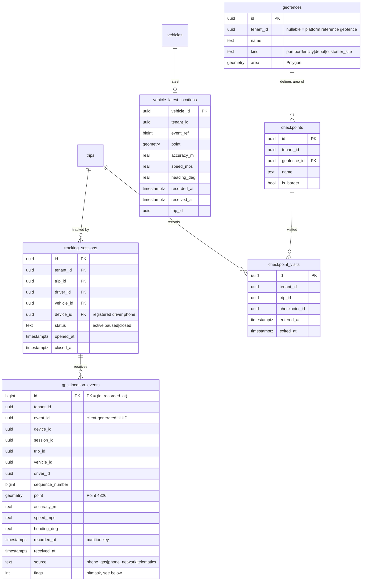

# Database design and ERD

PostgreSQL 16 + PostGIS. All primary keys are UUID (`uuid4`) except `gps_location_events` and the event and outbox tables, which use `BIGINT GENERATED ALWAYS AS IDENTITY` for insert speed (D-010). All timestamps are `timestamptz` (UTC). SRID 4326 for all geometries.

Legend for **Tenancy**: `T` = tenant-owned (has `tenant_id`, RLS policy, inherits `TenantOwnedModel`). `G` = global (no tenant; access controlled separately). `S` = special RLS rule.

## 1. ERD — identity and tenancy



Roles and permissions are platform-defined (`G`) for the pilot. Per-tenant custom roles are post-pilot (D-008). Platform Super Admin is the flag `users.is_platform_admin`, not a tenant membership.

## 2. ERD — logistics core



`trip_shipments` is the many-to-many link that lets one shipment use several trips, and one trip carry several shipments (consolidation). Containers ride on a shipment, not on a trip directly. Which container is on which trip is recorded in `trip_shipments.container_ids` (validated as a subset of the shipment's containers).

## 3. ERD — tracking and geofencing



### `gps_location_events` partitioning (D-012)

```sql
CREATE TABLE gps_location_events (
    id            BIGINT GENERATED ALWAYS AS IDENTITY,
    tenant_id     UUID NOT NULL,
    event_id      UUID NOT NULL,
    device_id     UUID NOT NULL,
    -- ...
    recorded_at   TIMESTAMPTZ NOT NULL,
    received_at   TIMESTAMPTZ NOT NULL DEFAULT now(),
    flags         INTEGER NOT NULL DEFAULT 0,
    PRIMARY KEY (id, recorded_at),
    UNIQUE (tenant_id, device_id, event_id, recorded_at)
) PARTITION BY RANGE (recorded_at);
-- monthly partitions gps_location_events_y2026m11 ...; a DEFAULT partition catches outliers
CREATE INDEX ON gps_location_events USING BRIN (recorded_at);
CREATE INDEX ON gps_location_events (tenant_id, trip_id, recorded_at);
CREATE INDEX ON gps_location_events USING GIST (point);
```

PostgreSQL requires unique constraints on a partitioned table to include the partition key. So the dedupe key from the brief, `(tenant_id, device_id, event_id)`, becomes `(tenant_id, device_id, event_id, recorded_at)`. The driver app generates `event_id` and `recorded_at` together at capture time and never changes them, so a legitimate retry always collides. See D-012 for the trade-off.

Django's `bulk_create(ignore_conflicts=True)` does not return primary keys for skipped or inserted rows on PostgreSQL. So ingestion uses `INSERT … ON CONFLICT DO NOTHING RETURNING event_id` through a cursor and treats event ids that are not returned as duplicates (D-012).

Validation flags (bitmask). Blocking flags prevent a latest-location update:

| Bit | Flag | Blocking |
|---|---|---|
| 1 | `low_accuracy` (> 100 m default) | yes |
| 2 | `out_of_order` (older than the device's last accepted) | yes, for latest-location only |
| 4 | `impossible_speed` (> 150 km/h implied) | yes |
| 8 | `clock_skew` (recorded_at more than 5 min after received_at) | yes |
| 16 | `while_paused` | no |
| 32 | `late_upload` (received more than 1 h after recorded) | no |
| 64 | `network_fix` (source not GPS) | no |

These are *rejected* (not stored): coordinates out of range, `recorded_at` more than 5 min in the future, `recorded_at` older than the retention window, no authorized session, vehicle or driver mismatch with the session, and malformed payloads.

Retention: a beat job creates partitions 3 months ahead. Partitions older than 12 months are exported to S3 as Parquet (or gzip CSV), verified by row count and checksum, then detached and dropped. The drop needs explicit approval in production (hard rule: data-dropping operations need approval).

## 4. Events, audit and platform tables

| Table | Tenancy | Notes |
|---|---|---|
| `shipment_events`, `trip_events`, `tracking_session_events` | T | Append-only. `actor_user_id`, `actor_kind (user, system, integration)`, `from_status`, `to_status`, `reason`, `payload jsonb`, `occurred_at`. The app role gets `INSERT`/`SELECT` only. `UPDATE`/`DELETE` are revoked (D-018). |
| `audit_logs` | S | `tenant_id` nullable (platform-level actions). Append-only via grants. RLS: tenant rows by `app.tenant_id`. Platform rows only via the admin role. |
| `outbox_events` | S | `id bigint`, `tenant_id`, `type`, `aggregate_type`, `aggregate_id`, `payload`, `created_at`, `published_at`, `attempts`. The relay runs in the worker under the `corridor_relay` role, which can read across tenants for this table only (D-007). |
| `idempotency_keys` | T | `(tenant_id, user_id, key)` unique, `request_hash`, `response_status`, `response_body`, `expires_at`. |
| `notifications` | T | In-app inbox. `recipient_user_id`, `kind`, `payload`, `read_at`. |
| `documents` | T | Metadata only. Files live in S3 under `tenants/{tenant_id}/…`, reached by pre-signed URLs. `visibility (internal, customer)`. |
| `tracking_links` | S | `token_hash` (SHA-256), `shipment_id`, `expires_at`, `revoked_at`, `allowed_fields`. Looked up by the `SECURITY DEFINER` function `public_resolve_tracking_link(hash)` (D-017). |
| `processed_messages` | G | Consumer idempotency for SQS handlers. `(handler, outbox_event_id)` unique. |

## 5. RLS template (applied by a migration helper to every `T` table)

```sql
ALTER TABLE {t} ENABLE ROW LEVEL SECURITY;
ALTER TABLE {t} FORCE ROW LEVEL SECURITY;
CREATE POLICY tenant_isolation ON {t}
    USING      (tenant_id = NULLIF(current_setting('app.tenant_id', true), '')::uuid)
    WITH CHECK (tenant_id = NULLIF(current_setting('app.tenant_id', true), '')::uuid);
GRANT SELECT, INSERT, UPDATE, DELETE ON {t} TO corridor_app;   -- append-only tables: SELECT, INSERT only
```

If `app.tenant_id` is unset, the predicate is `tenant_id = NULL`, which matches nothing, so the default is to deny. A CI test lists every table that has a `tenant_id` column and fails if any lacks RLS, `FORCE`, or the policy.
