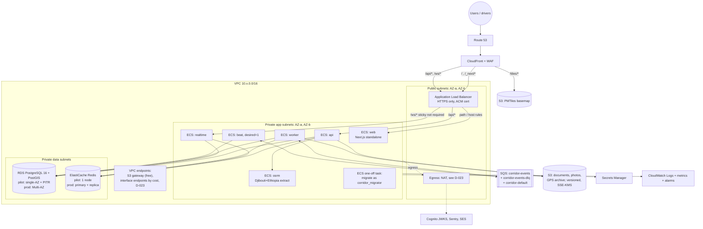

# Deployment architecture

Status: Phase 0 design. Terraform arrives in Phase 7. Nothing is applied without approval (MASTER_PROMPT §0.3). Region: **to be confirmed** (D-003). `me-central-1` is the working assumption.

## 1. AWS topology (per environment: staging, prod)

Notes:
- The database and Redis are never in public subnets. Security groups allow 5432/6379 only from ECS task security groups.
- WebSocket: ALB supports it natively. Idle timeout is raised to 300 s, and clients ping every 30 s.
- Each ECS service has its **own task role** (least privilege). Examples: only `worker` and `beat` can use SQS, only `api` and `worker` can write the documents bucket, and only `worker` can write the GPS archive prefix.
- Secrets (DB credentials per role, Fernet keys, Sentry DSN) live in Secrets Manager and are injected via ECS `secrets`. They are never in the image or in Terraform state as plaintext.

## 2. Pilot vs production configuration

| Component | Pilot | Production |
|---|---|---|
| api | 1–2 tasks (0.5 vCPU / 1 GB) | ≥ 2 tasks across 2 AZs, CPU/latency autoscaling |
| realtime | 1 task | ≥ 2 tasks (channels-redis groups make fan-out work across tasks) |
| worker | 1 task | ≥ 2, autoscale on SQS `ApproximateNumberOfMessagesVisible` + age |
| beat | 1 task | 1 task (singleton by design) |
| web | 1 task | ≥ 2 tasks |
| osrm | 1 task (~2 GB) | 2 tasks |
| RDS | single-AZ, smallest Graviton class that fits PostGIS + 300 trucks, PITR 7 days | Multi-AZ, PITR 14–35 days, tested restore each quarter |
| Redis | 1 small node | primary + replica, automatic failover |
| Backups | automated snapshots + PITR; RPO 24 h is met with margin | plus cross-region snapshot copy (once multi-region is decided) |

The monthly cost estimate per resource is written in Phase 7, from the AWS Pricing Calculator for the confirmed region, before any `terraform apply`.

## 3. Environments

| Env | Where | Data | Auth |
|---|---|---|---|
| dev | `docker-compose` on a laptop: postgis, redis, ElasticMQ (SQS-compatible, D-009), api, realtime, worker, beat, web, MailHog-style SMTP sink | seed data only, flagged `is_demo` | local Cognito-compatible JWT issuer for tests (D-006) plus an optional real dev user pool |
| staging | AWS, separate account (recommended) or separate VPC | synthetic data only | Cognito staging pool |
| prod | AWS, separate account | real data, after data-residency sign-off | Cognito prod pool |

## 4. CI/CD pipeline

```mermaid
flowchart LR
    A[push / PR] --> B[lint: ruff, eslint]
    B --> C[types: mypy+django-stubs, tsc]
    C --> D[unit tests: pytest-django, vitest, jest]
    D --> E[integration tests:<br/>postgis + redis service containers,<br/>connect as corridor_app]
    E --> F[makemigrations --check<br/>import-linter]
    F --> G[gitleaks, pip-audit, npm audit]
    G --> H[docker build backend + web]
    H --> I[trivy scan]
    I -->|main only| J[push to ECR]
    J --> K[deploy staging]
    K --> L[migrate one-off task]
    L --> M[smoke tests]
    M --> N{manual approval}
    N --> O[snapshot RDS]
    O --> P[migrate prod]
    P --> Q[deploy prod]
    Q --> R[health check, auto-rollback<br/>via ECS deployment circuit breaker]

    TF[PR touching infrastructure/] --> TF1[terraform fmt -check, validate, plan] --> TF2[plan posted to PR]
    TF2 -.apply only after human approval.-> TF3[terraform apply]
```

- GitHub → AWS authentication uses OIDC (no long-lived keys). The staging deploy role cannot touch prod.
- Migrations run **before** the new code is deployed, so migrations must be backward compatible (expand → migrate → contract). Migrations that drop or rewrite data are flagged by a CI check (`RemoveField`, `DeleteModel`, `RunSQL` containing `DROP`/`TRUNCATE`/`UPDATE`) and need an approval label.
- Terraform state: S3 bucket (versioned, encrypted) with native S3 state locking (`use_lockfile`, Terraform ≥ 1.10) or a DynamoDB lock table (decided in Phase 7).

## 5. Health endpoints

| Path | Checks | Used by |
|---|---|---|
| `/healthz/live` | process up | ECS container health |
| `/healthz/ready` | DB `SELECT 1` as app role, Redis ping | ALB target group |
| `/api/v1/ops/business-health` (authenticated, ops roles) | trucks in active sessions with no GPS for 30 min, outbox lag, DLQ depth | dashboard + CloudWatch custom metrics |
