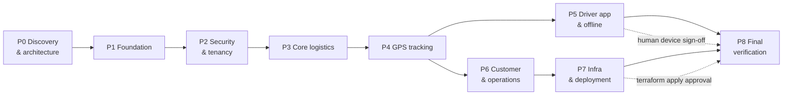

# Roadmap

One phase per working session (MASTER_PROMPT §0.1). A phase closes only when its Definition of Done passes, with evidence in PROGRESS.md.

| Phase | Main deliverables | Human gates | Key risks |
|---|---|---|---|
| **0 Discovery** | Architecture, ERD, security model, deployment design, state machines, decisions | Confirm region/residency (D-003), budget, telematics/rail scope (D-025, D-026) | Unconfirmed legal constraints |
| **1 Foundation** | Repo skeleton, Django project with all module apps, Docker image, compose (api, realtime, worker, beat, postgis, redis, elasticmq, web), Next.js shell, Expo shell, structlog + correlation IDs, Sentry wiring, CI (lint, types, tests, makemigrations --check, import-linter, gitleaks) | none | **Docker is not installed on the current workstation** (see PROGRESS.md). Compose validation needs Docker Desktop or CI |
| **2 Security & tenancy** | DB roles, `TenantOwnedModel`, tenant middleware, RLS migration helper + coverage test, Cognito JWT verification, memberships, roles/permissions, MFA gate, audit log, Channels auth, `@tenant_task`, security test suite | A real Cognito dev pool for end-to-end login (or the local issuer for tests) | Async views + `SET LOCAL` correctness; RLS performance on large tables |
| **3 Core logistics** | customers, containers (ISO 6346), shipments, fleet, drivers, dispatch, trips, state machines, idempotency, outbox + relay, ops UI screens (lists, detail, dispatch) | none | Getting module boundaries right without over-abstracting |
| **4 GPS tracking** | Sessions, partitioned events table, validation pipeline, batch API, latest-location upsert, freshness, retention/archive job, live map (MapLibre + PMTiles), realtime fan-out, corridor reference geofences (coordinates verified with operators, D-027) | Approval before any partition drop in prod | Map tile hosting, ingestion latency target |
| **5 Driver app** | Expo dev build, auth, trips, foreground-service tracking, SQLite queue, sync engine, battery-optimization guidance, status UI, emulator test suite incl. 10,000-event sync, device test plan | **Human real-device sign-off (Android required)** | OEM background killing (Tecno, Infinix, Samsung, Xiaomi are common in the region) |
| **6 Customer & ops** | Public tracking links, customer portal, geofence/checkpoint events, border arrival vs clearance, deterministic ETA, email + in-app notifications (SES adapter + test adapter), delivery confirmation (photo, signature) | Approval before sending any real email | Routing coverage on the corridor (OSRM evaluation) |
| **7 Infrastructure** | Terraform modules (network, ecs, rds, redis, sqs, s3, cognito, cloudfront/waf, monitoring), staging env, cost estimate, runbooks, backup/restore test | **terraform apply approval**, first prod migration approval | Region service availability; NAT/egress cost |
| **8 Verification** | Full test run, k6/Locust load test (300 trucks + 100 office users), security review, final report | Pilot go/no-go | — |

## Post-pilot (interfaces designed now)
- `billing`: invoices and payments behind a `PaymentProvider` interface (D-Money, Waafi, CAC Pay adapters)
- `analytics`: read models and reporting
- SMS/WhatsApp `NotificationChannel` adapters
- `ai`: advisory-only features. It never mutates state (hard rule 9)
- Telematics device ingestion (`source = telematics`, device-auth path)
- Rail/multimodal (`trips.mode`)
- Multi-region
